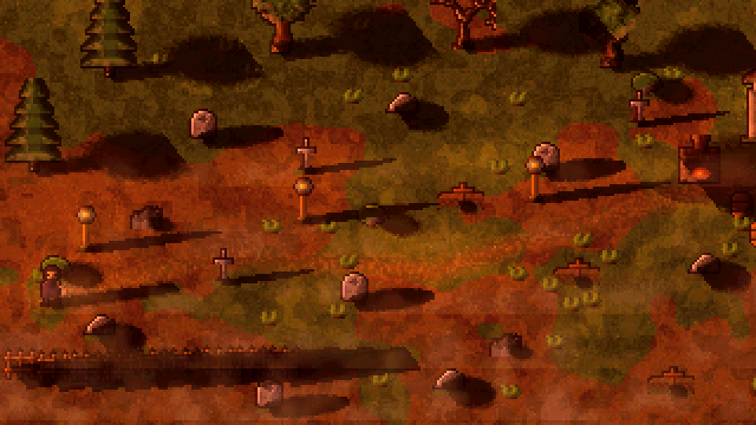
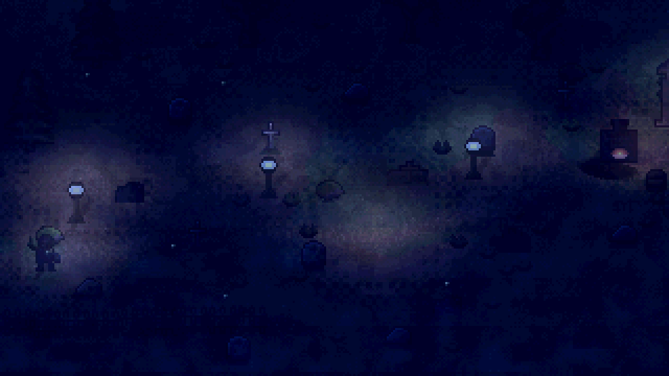
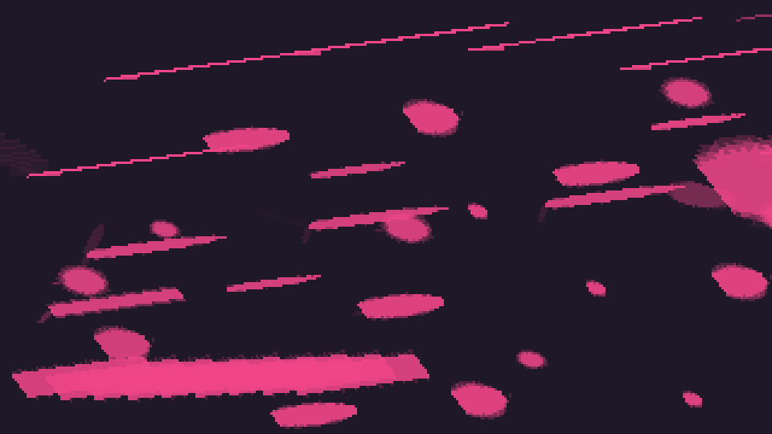
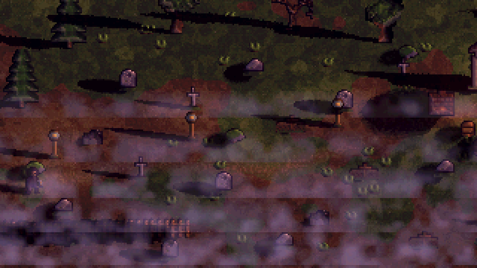
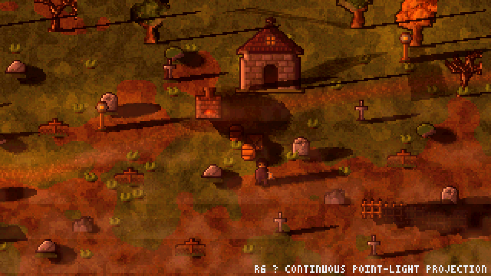
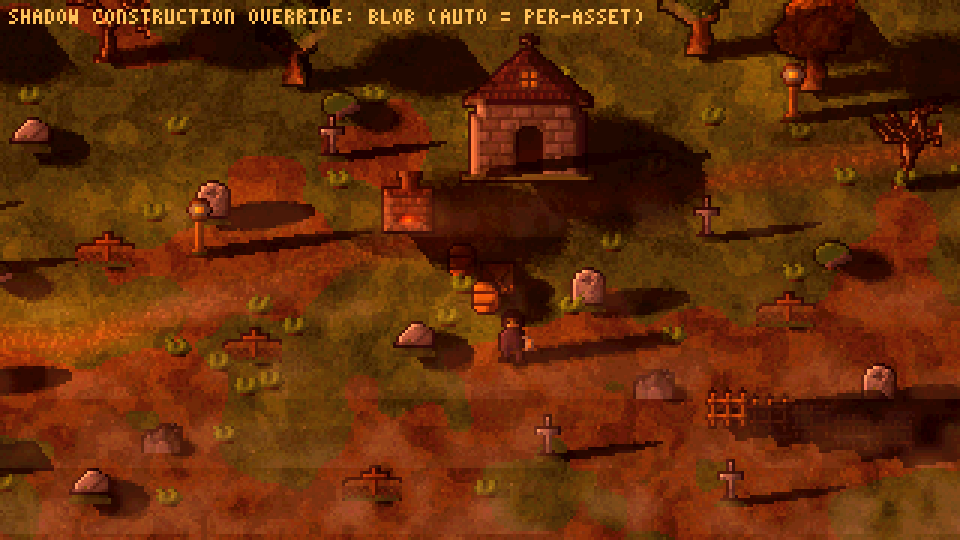

# Pixel-art dynamic shadow generator

A dependency-free JavaScript prototype of the shadow technique described in
Svyatoslav Cherkasov’s write-up
[“Graveyard Keeper: how the graphics effects are made”](https://www.gamedeveloper.com/programming/graveyard-keeper-how-the-graphics-effects-are-made),
plus the surrounding lighting pipeline the article places it in.

Everything runs on the CPU against plain `Uint8ClampedArray` framebuffers at an
internal resolution of **320×180**, scaled up with `image-rendering: pixelated`.
There is no WebGL, no build step and no dependencies — the “vertex shader”, the
“fragment shader” and the “sprite batch” are small, readable JavaScript
functions, which is exactly what makes the technique inspectable here.

## Run it

```bash
cd shadow-prototype
python3 tools/serve.py          # static server that sends Cache-Control: no-store
# open http://localhost:8080
```

`tools/serve.py` is plain `http.server` plus no-store headers: without them
browsers apply heuristic freshness to the ES modules and can keep running old
code after an update. The HUD shows a `build` stamp so a stale page is
recognisable at a glance. Any other static server works too — just hard-reload
after pulling changes.

Headless smoke test + verification screenshots (writes `tools/shots/*.png`):

```bash
node tools/headless.mjs          # 22 shots + sanity asserts
node tools/headless.mjs --bench  # frame-time / cache / broad-phase benchmark
```

## What it looks like

| golden hour — long sun shadows from every prop | night — torch/lamp pools cut by shadows |
| --- | --- |
|  |  |

| the shadow coverage mask (what the raster stage outputs) | 100% fog with altitude simulation |
| --- | --- |
|  |  |

| chapel shadow, silhouette projection (default for big casters) | same frame with the article's rotating-blob sprite — note how it pivots around the centre instead of staying planted at the walls |
| --- | --- |
|  |  |

## What is implemented, quote by quote

| Article | Implementation |
| --- | --- |
| “Shadows are made with sprites rotating around a point.” | `ShadowCaster.pivot` + `ShadowSystem.vertexStage()` — a black shadow sprite is rotated around the object’s feet. No transform is ever modified. |
| “I tried to add a skew there, but it turned out to be unnecessary.” | `shadowCfg.skew` exists in the vertex stage and defaults to `0`; drag it in the panel to repeat the experiment. |
| “Every object may have a maximum of 4 shadows. The shade from the sun and the additional three from dynamic light sources.” | `ShadowCaster.slots` = 4 `ShadowSlot`s. Slot 0 = sun (the moon after dark), slots 1–3 = the nearest lights, re-picked every frame. The `max dynamic shadows` slider shows what dropping to 1–2 costs visually. |
| “how to find the closest 3 light sources and to calculate the distance and an angle was solved with a script running in the Update() loop … not the quickest way” | `ShadowSystem.assign()` is that loop, timed live in the HUD (`shadow assign`). `LightGrid` is the spatial-hash broad phase (“if I programmed it today”) — toggle it and watch the timer; with only ~7 lights in this scene the flat loop actually wins, which is the honest trade-off. |
| “I did the sprite rotation … inside a vertex shader … You just put a parameter to a sprite (I used the color channel for that, all the shadows are black anyway).” | Each shadow carries a packed `RGBA8` vertex colour: **R = rotation angle, G = length, B = intensity, A = width**. `packShadowColor()`/`unpackShadowColor()` emulate the 8-bit `Color32` round-trip (the live “angle quantisation” readout shows the ≤1.4° error it introduces), and `vertexStage()` decodes it and transforms 4 corners — the fragment/raster stage then only does an inverse-affine UV solve and a nearest-neighbour sample. |
| “the sprite is highly distorted vertically (the shadow sprite original looks like a circle). That’s why its rotation looks like not just a simple rotation but also like a distortion.” | `squashY` foreshortens the ground plane in the vertex stage; the shadow textures are round blobs, so rotating them under the squash produces the characteristic wobble. The `shadow mask` view and the `squash` slider (try `1.0`) make this obvious. |
| “we used about ten different more or less universal sprites (thin, thick, oval etc.)” | `makeShadowSet()` builds 9 universal blobs: `blob, oval, thin, thick, tree, human, fence, chapel, mound`, each authored as a distance field with ordered-dither alpha so it stays crunchy at any size. |
| “It’s difficult to make a shadow for an object that is stretched along one axis. For instance, look at the fence shadow.” | The fence run at the front of the graveyard uses the stretched `fence` blob; compare it with the `thin`/`oval` graves. |
| “The downside is that shadows must be adjusted and drawn separately for each object.” | Every asset carries its own shadow profile (`shadow:` preset, length/width scales, pivot) **and its own construction style** — see the next section. The chapel and the trees opt into silhouette projection; graves and props keep the cheap rotating blob. |
| “Dynamic ambient light is just change of illumination depending on the time of the day … gets blue tint.” | `ambientColorGradient` + `ambientIntensity` in `lighting.js`, sampled every frame; night goes blue and dark. |
| “LUT color-correction … that 3D texture is represented as two-dimensional.” | A real 32×32×32 LUT flattened into the 1024×32 strip, generated for 7 grade styles (`night, dawn, day, golden, dusk, crypt, identity`), cross-faded by time of day. The strip is drawn live in the panel, and the colour pass is one 15-bit table lookup per pixel. |
| “Normal maps — make objects look like they have a real volume.” | Every sprite gets a tangent-space normal map merged from its painted shading + silhouette curvature (`PixelCanvas.makeNormals`), i.e. the “paint light on 4 sides, merge with a script” workflow done by script. The `normal maps` view shows them. |
| “The math of light 3D distribution … the back one is illuminated while the front one is not.” | `verticalFacingFactor()`: `dy = light.y - sprite.y`; negative (light behind the sprite) fades the light “at a very quick rate” (exponential, rate adjustable). Walk the keeper past a lamp and watch the near side of props go dark. |
| “Dynamic light sources — torches, ovens, lamps.” | Lamps on posts, the brick oven (flickering fire light), the keeper’s hand lantern and user-dropped torches. Light pools accumulate in ground space; additive glow sprites fade with daylight (“the intensity of the light sprites changes depending on the time of day”). |
| “Object altitude simulation — for the fog to be displayed correctly.” | `FogSystem`: horizontal cloud bands, each with an altitude threshold; a per-pixel altitude buffer (written by the sprite pass) makes treetops and roofs poke out of the fog. The `altitude (fog)` view shows the buffer; the fog slider goes to the article’s “extreme 100% fog”. |
| “wind … a deforming shader … the highest point will be shaken the most intensely” | Per-scanline horizontal offsets weighted by `(height above base)^power` with a per-object phase — applied to grass, bushes and tree crowns at blit time. |

## Big casters: silhouette projection and self-shadow exclusion

The rotating blob is exactly what the article ships, and it is perfect for
graves, barrels and people. It breaks down on *tall* casters (the chapel, the
pines): a blob pinned to one pivot can only swing around the object's centre,
so at low sun the "shadow" looks like a decal rotating under the building
instead of a silhouette falling away from its walls, and the coverage mask —
which is applied to everything drawn after it, including the caster itself —
ends up darkening the chapel's own facade.

Two optional construction modes fix both halves of that, and both are
toggleable in the panel so the difference stays inspectable:

- **`project` (silhouette projection).** Instead of one quad per light, the
  raster stage walks the caster's own opaque pixels. A pixel at altitude
  `alt` above the pivot lands at `groundPos + sunDir · alt · K` for the sun
  (so the roof tip travels furthest and the wall foot stays planted — the
  shadow keeps the silhouette's shape, sheared along the sun azimuth), and at
  `groundPos + horiz · alt/(lightZ − alt)` for point lights, skipping pixels
  above the lamp because those rays never come back down. `K` and the
  point-light factor are scaled so the tallest pixel lands inside
  `project reach`, which preserves the silhouette gradient instead of
  flattening the whole roof into one edge. A small per-column north spread
  (`project depth`) gives billboards a footprint so a due-east sun does not
  collapse them to a 1-pixel line, and a per-column fill bridges vertical
  gaps. The chapel and all trees use it; force it on everything with the
  *shadow construction* select to see why graves do not need it.
- **Self-shadow exclusion.** Before the object pass, each visible caster's
  own slots are re-rasterised into a private coverage buffer clipped to the
  sprite's bounding box. When the sprite is blitted, its own contribution is
  divided back out (`others = 1 − (1 − total)/(1 − own)`), so the drop shadow
  only darkens the ground and whatever stands in it — never the caster that
  threw it. The ground keeps the full mask. `self shadow` in the panel
  re-enables the naive behaviour for comparison.

`shadow construction: auto` (the default) honours each asset's declared style;
`blob` and `project` override globally. The inspector's slot readout shows
which style each caster is actually using.

## The frame pipeline

`src/renderer.js` runs, in order, and times each pass for the HUD:

1. **light pools** – per-light spherical attenuation accumulated into a ground-space RGB buffer.
2. **shadow assign** – the Update() loop: sun direction + 3 nearest lights per caster → packed vertex colours.
3. **shadow raster** – vertex stage (4 corners) + fragment stage (inverse affine, nearest sampling) into a screen-space coverage mask; casters whose style is `project` rasterise their sheared silhouette here instead, and a private per-caster copy (clipped to the sprite box) is kept for self-shadow exclusion.
4. **ground** – `albedo × (ambient + sun·sin(elev) + light pools)`, multiplied by the shadow mask (or, in `physical` mode, the mask removes direct light from the pool buffer instead).
5. **objects** – depth-sorted; per-pixel normal-mapped lighting with the sun + dynamic lights + 3D distribution; results cached against a 52-bit quantised light probe (the “works really fast” story — the benchmark shows the objects pass is ~2.3× faster with the cache).
6. **glows** – additive lamp/oven halos and fireflies, scaled by night-ness.
7. **fog** – altitude-tested cloud bands.
8. **LUT** – one table lookup per pixel.
9. **debug overlay** – a 3×5 bitmap font drawn into the pixel buffer.

## Controls

| Input | Action |
| --- | --- |
| drag a lamp/torch/oven light | move the light source (shadows re-aim live) |
| shift + click | drop a new torch (`x` removes the last one, `l` drops one at the keeper) |
| click an object / `tab` | select a caster and inspect its 4 shadow slots + packed vertex colours |
| wheel / shift + wheel | selected light radius / height `z` |
| `wasd` / arrows | walk the keeper (his lantern shadow follows) |
| `space` | pause the day · `,` `.` step time |
| `1`–`5` | views: final, shadow mask, light pools, normal maps, altitude |
| `q e r t y p u` | debug overlays: shadow quads, light radii, light links, vertex colours, broad-phase grid, pivots, sun vector |
| `f` / `n` / `g` / `h` | fog on/off, wind on/off, grid broad phase, shadows on/off |
| panel — *shadow construction* | `auto` (per-asset style) / `blob` (article technique) / `project` (silhouette shear) for every caster |
| panel — *project depth*, *project reach* | footprint spread and max throw distance of the projection style |
| panel — *self shadow* | re-enable casters darkening themselves (default off — see above) |

## Files

```
index.html            UI shell (controls are data-bind driven)
styles.css            panel/HUD styling
src/util.js           math, PRNG, noise, gradients, LUT io
src/framebuffer.js    CPU render target + blend modes
src/pixelart.js       PixelCanvas, normal-map merge, shadow blob sprites
src/sprites.js        the pixel-art asset library (ASCII art + generators)
src/lighting.js       ambient gradient, sun/moon, lights, LUT styles
src/shadows.js        ShadowCaster/Slot, packed vertex colour, vertex+fragment stages, LightGrid
src/terrain.js        pre-baked ground albedo
src/fog.js            altitude-tested fog bands
src/scene.js          the graveyard layout, keeper, camera
src/renderer.js       the frame pipeline
src/debugfont.js      3x5 bitmap font for in-buffer labels
src/main.js           bootstrap, input, HUD, inspector
tools/headless.mjs    smoke test + screenshot harness (node, no DOM)
tools/png.mjs         tiny PNG encoder for the harness
```

## Known limits (deliberate, and instructive)

- Shadows live on the ground plane; they do not project onto vertical surfaces
  (same as the shipped technique — they are ground decals rotated around a pivot).
- The lit-sprite cache quantises each light to a 6-bit angle / 3-bit intensity /
  3-bit facing probe; sprites touched by more than 3 lights bypass the cache so
  they stay exact.
- With ~7 lights the brute-force nearest-light loop beats the spatial grid;
  the grid is the asymptotic answer, not the small-scene one.
- The LUT is a nearest-sample 32³ table, so very smooth gradients show its
  5-bit-per-channel steps — authentic, and hidden by the scene’s dithering.
- Silhouette projection is a ground-plane decal too: it shears the sprite’s
  own outline, so it cannot show gaps the real shadow volume would (lattice
  windows, branches between leaves), and a point light exactly at sprite
  altitude has no defined landing point (those pixels are skipped).
- Projection cost scales with caster pixel area, not with 4 quads; fine for
  the handful of big casters here, wrong tool for a forest of them.
